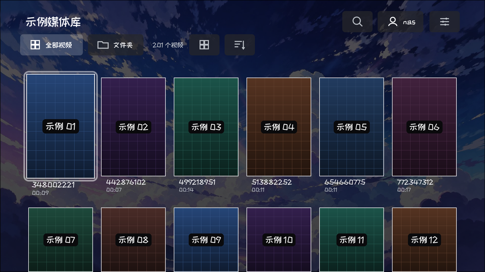
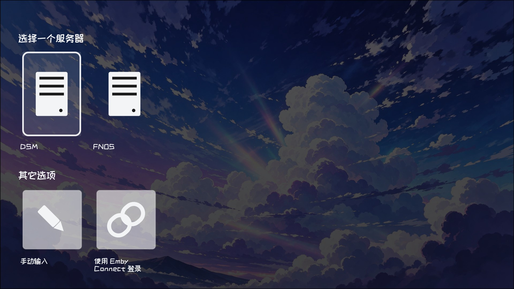

# LonYao — Emby 安卓 TV 客户端

一个为电视/投影仪手写的 Emby 客户端，纯 Java 实现，不依赖 Gradle，直接用 Android SDK 的
`aapt2 / javac / d8 / zipalign / apksigner` 手工构建，整个 APK 只有 40 多 MB。

面向个人自建的媒体库：客户端本身不附带、不索引任何内容，所有影片、字幕、封面都来自
你自己连接的 Emby 服务器。

界面按电视的操作习惯重做：全屏海报墙、D-pad 焦点环、遥控器友好的设置面板，
所有可聚焦控件使用同一套白色玻璃焦点环。

除了影片，它也为**图片类库**做了专门优化：媒体库里可以直接放写真、剧照、漫画扫描页，
不需要塞进视频里；全屏查看时能一直放大到原图像素级别，8K 图放大后细节依然清楚。

## 预览

| 首页（虚拟库演示） | 媒体库（海报墙） | 连接服务器 |
| --- | --- | --- |
|  |  |  |

## 功能

### 首页

- 顶部导航：`首页 / 收藏 / 搜索 / 账号 / 设置`，遥控器左右键切换，当前项高亮
- 全屏 banner 轮播：整屏海报背景 + 标题、年份、时长、分辨率、`详情…` 入口，底部圆点指示页码，
  可自动轮换，也可以按左右键手动翻
- 媒体库入口：每个库一张横版卡片，显示库封面和自己起的库名（电影 / 剧集 / 家庭照片 …），
  卡片尺寸可调，焦点停在卡片上会放大
- 海报墙：每行数量、卡片大小可设；缩略图等比铺满卡片可用空间，不做裁切

### 媒体库

- 两种浏览方式：**网格视图**和**文件夹视图**。文件夹视图进去后能直接看到每个文件对应的
  封面、剧照缩略图，适合按目录整理好的库
- 每个条目显示封面、标题、年份、时长，以及评分 / 分辨率角标
- 排序 16 项：IMDb 评分、分辨率、加入日期、发行日期、媒体容器、家长分级、年份、
  影评人评分、播放日期、播放时长、播放次数、文件名、文件尺寸、标题、比特率、随机
  （随机每次进入都会重新洗牌）
- 图片类内容（剧照、写真、家庭照片、漫画扫描页）同样按网格铺开，和视频混在同一层里，
  卡片上直接显示缩略图，点进去可以全屏看大图
- **照片库专用入口**：如果这个库的类型是「照片」或「家庭视频与照片」，媒体库里除了「文件夹」
  按钮还会多出一个「照片」按钮，点它就把整个库里所有图片一次性铺成照片墙（不是只显示当前
  文件夹），标题栏会显示「N 张照片」，边滚边续，几万张的库也能翻到底
- 从照片墙退出会回到主界面，不会莫名其妙退回到上一次进过的子文件夹

### 图片浏览

**电视当观片器**：写真、摄影图、漫画扫描页直接丢进媒体库就能看，不用为了「能在电视上打开」
而把每张图转成视频。电视面板越大越能体现出差别 —— 8K 图放大到细节，是原图像素，
不是把缩略图拉伸出来的糊块。

- 媒体库里图片和视频并排显示，图片卡上就是缩略图，卡片副标题直接标原始尺寸
  （`8237 × 12355`），挑图时一眼知道这叠图有多高清
- 点开就是**全屏大图**，同目录下的图片用**左右键连续翻看**，一叠写真可以一路翻到底
- 照片**永远按自己的原始宽高比完整显示**：不裁切、不拉伸、不套竖框。竖图占满屏幕高度、
  横图占满屏幕宽度，两侧或上下留出的黑边是照片本身比例（比如 9:16）造成的，不是界面边框
- **上下键缩放，1x 到 24x**，步长随倍数自适应（2x 以内 0.25 一档、4x 以内 0.5、8x 以内 1、
  16x 以内 2、再往上 4），放大锚点固定在画面正中，不会越放越偏
- **放大后看到的是原图，不是预览图**：图像按 2048 像素的网格切块，只解码屏幕当前可见的
  那几块。所以放到 24x 时是原图 1:1 像素（8K 图就是真实的 8000 多像素宽），发丝、
  布料纹理、皮肤细节都能看清，又不会因为整张 8K 图塞进显存而花屏或卡死
- 原图是按需下载的：先出 1080p 预览，点开立刻有画面；放大到一定程度才在后台拉原图
  （单张 8K 原图常见 30MB 上下，走本地局域网几秒），原图下完的瞬间画面不会跳回 1x，
  你可以继续放大
- 未放大时按确认键也能进「可移动」模式，方向键上下左右平移画面，平移范围夹在图片边界内，
  不会拖出空白
- 再按确认键退出移动模式，**退出后保留你移动到的位置**，可以接着在这个位置继续放大
- 屏幕底部有一条操作提示，显示当前是「可移动」还是「可缩放」，不用背操作
- 缩放状态下左右键切图，上一张的高清分块会被立刻释放，画面干净、没有残影

### 详情页

- 全屏背景剧照 + 海报 + 简介，演职员列表带角色名与头像
- 剧集展开成分集列表，每集带缩略图、时长与简介
- 字幕与音轨选择、直接播放 / 强制转码、断点续播
- 按钮顺序：已看 → 收藏 → 删除。删除按钮可以在设置里关掉，开着的时候点一下**直接删除
  服务器上的文件**，不弹任何确认框，删完自动退回上一级并刷新网格

### 播放

- 两条播放路径：内置 VLC 内核（软解兜底，兼容冷门编码）与系统播放器
- 左右键快进快退、上下键调音量、菜单键切字幕与音轨
- 字幕分三类：**内嵌字幕**（视频文件里自带的字幕轨，按语言/标题列出真实轨名）、
  **外挂字幕**（同目录的 .srt / .ass 等外部文件，二级菜单展开选择）、本地字幕
- 转码档位：分辨率可选 `8K / 4K / 2K / 1080p / 720p / 480p / 原画`，
  码率可选 `80 / 40 / 20 / 10 / 5 / 2.5 / 1.2 Mbps / 不限`，带宽够的时候可以让服务器
  按 8K、4K 原分辨率转码，不必一路压到 1080p
- 播放统计面板按官方 TV 版三段式重做：「播放信息 / 流媒体信息 / 原始媒体信息」——
  流媒体信息是当前这次播放的实际状态（直连还是转码、分辨率、码率），原始媒体信息是
  文件本身的参数，两边不会串
- 倍速切换 0.5x–3x，切换后不会先回落到 1x 再跳到目标档位
- 老编码（RMVB / RV40 / MPEG-2）按住快进快退时进度条不再来回摆动

### 搜索

- 全库搜索，结果以海报网格呈现
- 从搜索结果进详情、播放后一路返回，仍然停在搜索结果页而不是弹回首页

### 登录与服务器发现

- 选择服务器页会自动搜索局域网里的 Emby：先发 UDP 7359 广播（响应快的服务器一两秒就出来），
  **同时**并行扫描本机网段 254 个 IP 的 8096 端口补齐——装在 Docker / 容器里的自建 Emby
  往往不响应广播，只靠广播永远搜不到，两条路一起走才搜得全
- 服务器没设名字也能识别出来，卡片上直接用 IP 兜底显示；搜到一台就立刻插一张卡片，
  不用等全部扫完
- 支持记住多台服务器、扫码 / 手动输入地址、Emby Connect 账号登录
- 选中服务器后自动查出用户名，只输密码就能进

### 安全

- 启动密码：开启后进入 App 要输密码
- **切出去再回来必须重新验证**：按 Home 键或切到其它应用，回到 App 时一律退回极简登录页，
  不会因为任务残留在后台就直接进主界面；只有「进播放器再返回」不算切出去，不会打断你看片
- 回到登录页会自动把焦点放回密码框，方向键/确认键立刻可用
- 后台防窥：最近任务里的应用预览是遮罩过的，不会露出正在看的内容

### 设置

- 界面风格：玻璃风 / 官方 Emby 风
- 缩略图比例与大小、每行卡片数量、卡片尺寸
- 焦点框颜色与样式，全应用统一
- 点视频先看详情（而不是直接开播）
- 启动密码、后台防窥（切出应用时自动遮罩）、自定义背景图
- 详情页删除按钮的显示 / 隐藏
- 服务器管理：切换、删除、重新登录

## 构建

需要：

| 依赖 | 用途 |
| --- | --- |
| JDK 17 | javac / jar / keytool |
| Android SDK Build-Tools（含 `aapt2`、`d8`、`zipalign`、`apksigner`） | 资源编译、dex、对齐、签名 |
| `android.jar`（API 28 及以上） | 编译期 bootclasspath |
| [AndroidX Media3](https://github.com/androidx/media) 的 jar | ExoPlayer 相关 |
| [VLC for Android](https://code.videolan.org/videolan/vlc-android) 的 `classes.jar`、`jni`、`assets` | 播放内核 |
| `zxing core` jar（可选） | 二维码生成 |

把上面这些二进制放进工程目录的 `deps/`，目录结构：

```
deps/
├── android.jar
├── zxing/core-3.5.3.jar
├── media3/jars/*.jar
└── vlc/
    ├── classes.jar
    ├── jni/armeabi-v7a/*.so
    └── assets/
```

然后：

```bash
# 可选：指定 SDK/JDK 目录与输出目录
set ANDROID_BUILD_HOME=C:\path\to\sdk-and-jdk
set EMBY_OUT_DIR=C:\path\to\output

python build.py
```

脚本会依次执行资源编译 → javac → d8 → 组装 APK（dex、so、assets、资源）→ zipalign →
apksigner，最后输出 `EmbyTV.apk`。首次构建时如果没有 `debug.keystore`，会自动用
`keytool` 生成一个用于本地调试的签名。

## 说明

- `deps/`、`*.apk`、签名文件、临时脚本都不会进入本仓库（见 `.gitignore`）。
- 本项目是非官方客户端，与 Emby LLC 无关联。「Emby」是其各自权利人的商标，
  仓库内不包含任何 Emby 服务端代码、影视内容或第三方素材。
- 播放内核 VLC 以 LGPL/GPL 授权分发，如需再分发请遵循其许可证要求。

## 许可证

[GPL-3.0](LICENSE)。可以自由使用、修改、分发，衍生作品需以同样协议开源；
如需闭源商用请联系作者另行授权。
