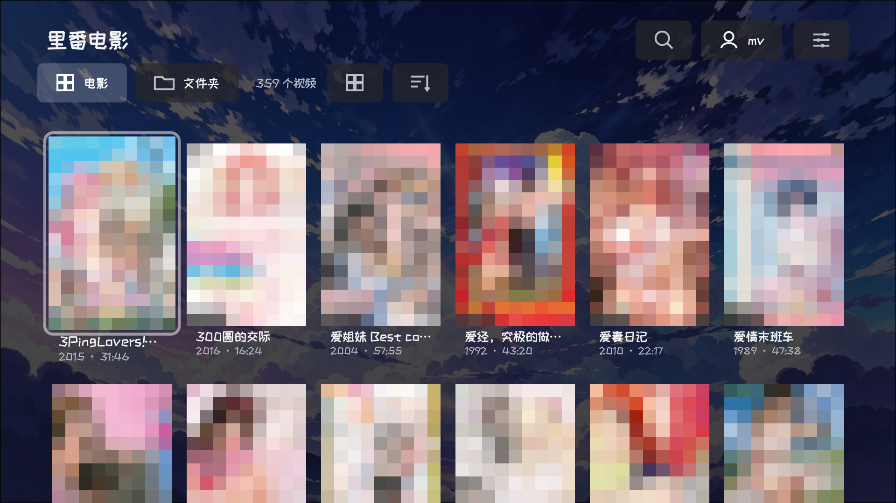
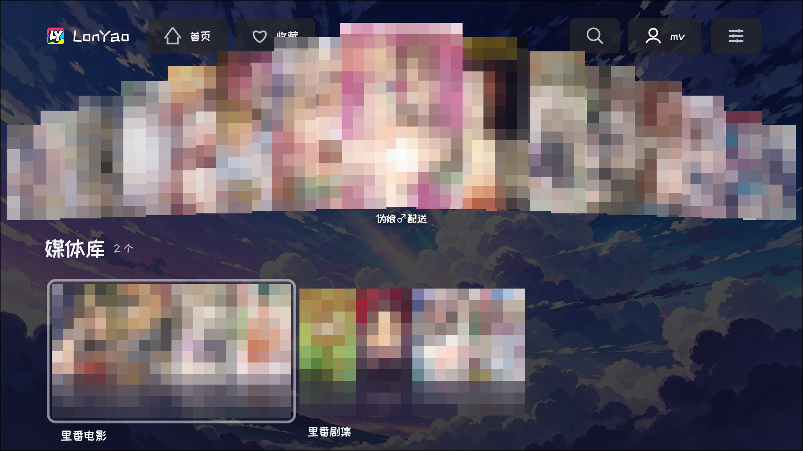
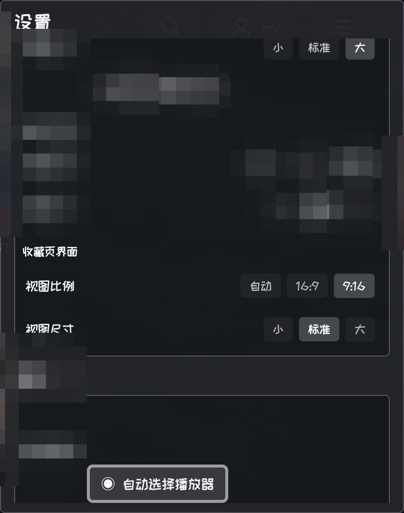

# LonYao · 第三方 Emby TV 客户端

一款自己折腾出来的 Android TV 版 Emby 客户端，包名 `com.longyao.anbitv`，全程用 Java 写、不用 Gradle 构建。

这是作者**第一次借助 AI 开发**的完整 App：从零开始，一边学一边改，前后迭代了几十版。界面按电视遥控器的操作习惯重新设计，不是手机端的简单拉伸。

**本仓库不提供源码，只提供 APK 附件。** 需要自备 Emby 服务器和账号，App 本身不含任何内容源。

---

## 截图

主界面：顶部轮播海报，下面一排媒体库，再往下是最近观看和收藏。

媒体库列表：卡片、名称、影片数量一眼能看清。

搜索页：不输关键词时随机推荐，输关键词后实时出结果。

设置页：外观、首页、列表、播放、隐私，一页竖排列，方向键切换。

首次启动的登录页：填服务器地址和账号密码。

---

## 主要功能

### 1. 主界面轮播

首页顶部是一条自动轮播的海报带，取媒体库最新加入的影片，横向堆叠、中间放大，焦点移到哪张就切到哪张，不抢焦点、不打断操作。

轮播可以关掉（设置 → 首页 → 顶部轮播），关掉后直接进媒体库那一排。

### 2. 海报比例适配（重点）

电视上最难受的就是海报被拉变形。这个 App 的处理：

- 列表默认「自动」：**竖版大海报一律按 9:16 显示，横版视频按 16:9 显示**，同一行里两种比例混排、等高对齐，不被拉伸、不留黑边，一行能塞几张塞几张。
- 手动 16:9 档：横图铺满整行，竖图左右留黑边（图不变形）。
- 手动 9:16 档：竖图铺满，横图上下留黑边。
- 有刮削竖海报的条目，**优先按 9:16 出图**，不会被档位强行塞成横的。

这条对里番、成人影片、老剧这类海报比例混乱的库特别有用——同一个文件夹里 9:16、16:9、4:3 混着来，也不会出现一张图撑满一行、下一行只剩半张的排版事故。列表最后一行不满时**不会拉伸占满整行**，保持原比例。

### 3. 密码锁（可开关）

App 可以加一道启动密码：打开时先出密码页，输对才进主界面，防止客厅里别人顺手点开。

- 设置 → 隐私 → 启动密码：开 / 关
- 开着的时候每次冷启动都要输一次，输错不给进
- 不需要就关掉，关掉后直接进首页，不弹任何东西

### 4. 隐私设置

- **隐私遮罩**：开 / 关。打开后切到后台（按 Home、来电、别的应用盖上来）会自动遮住画面，回到前台再恢复，避免别人瞟一眼就看到内容。
- 遮罩只在后台生效，不影响正常看片。
- 这两项都跟账号无关，换服务器也跟着走。

### 5. 照片与写真浏览

Emby 里的图片库、写真集也能当媒体库打开：

- 图片按原始比例显示，不裁不拉伸，点开全屏看大图
- 支持照片墙模式（多张并排铺满）
- 退出全屏回列表，焦点回到原来那张

### 6. 其它

- 搜索页空关键词时给一屏随机推荐，有剧集的条目右上角直接标「N 集」，电影标「电影」，带评分角标
- 媒体库详情、剧集详情有完整简介文字（刮削来的 Overview 全文显示，不截断）
- 收藏页、已看列表
- 播放器可选：自动 / 强制 Exo / libVLC，老片源（MPEG-TS 之类）Exo 播不动会自动回退 VLC
- 播放中按住快进/快退按倍率连发，松手落点
- 主题：黑绿 / 玻璃两套，全局字体、字号、背景可换

---

## 安装

1. 到本仓库右侧 **Releases** 下载 `LonYao-*.apk`
2. 电视/盒子上安装（U 盘拷过去用文件管理器装，或者电脑上 `adb install -r LonYao.apk`）
3. 打开 App

要求：Android 5.0 以上，遥控器能用的电视或盒子都行（已在投影仪上长期使用）。

## 用法

1. **登录**：启动后填 Emby 服务器地址，例如 `http://192.168.1.10:8096`，再填用户名密码。
2. **首页**：方向键左右切轮播和卡片，OK 进入。按「首页 / 收藏 / 搜索 / 账号 / 设置」顶栏图标可以换页。
3. **媒体库**：点进任意库看全部影片；进入文件夹后按返回回到上一层，再按一次回首页顶部（不会停在半路）。
4. **详情页**：看简介、季集列表，OK 播放，长按可收藏。
5. **搜索**：顶栏搜索图标进去，直接打字搜；清空关键词回车会回到随机推荐。
6. **设置**：顶栏最右边。方向键上下走，OK 选档位，返回键退出设置。

## 常见问题

**装了打不开 / 白屏？**
确认是 Android 5.0 以上的设备，安装时允许未知来源。

**海报不显示？**
进设置 → 列表 → 清除图片缓存，或者检查服务器能否直连（App 走的是服务器的图片接口）。

**播放卡、一直转圈？**
设置 → 播放 → 播放器选择，切到「强制 libVLC」试试；老片源用 Exo 容易卡。

**密码锁忘了？**
卸载重装（会清掉本地配置，服务器上的数据不受影响）。

## 说明

- 本仓库只放 APK 与截图，**源码不开源**。
- App 是纯客户端，不提供、不内置、不分发任何影视内容，所有内容来自你自己的 Emby 服务器。
- 请自行确保所访问的内容合法合规，不要用于传播侵权或违法内容。
- 用着顺手可以请作者吃个拼好饭，纯自愿，不影响任何功能。
